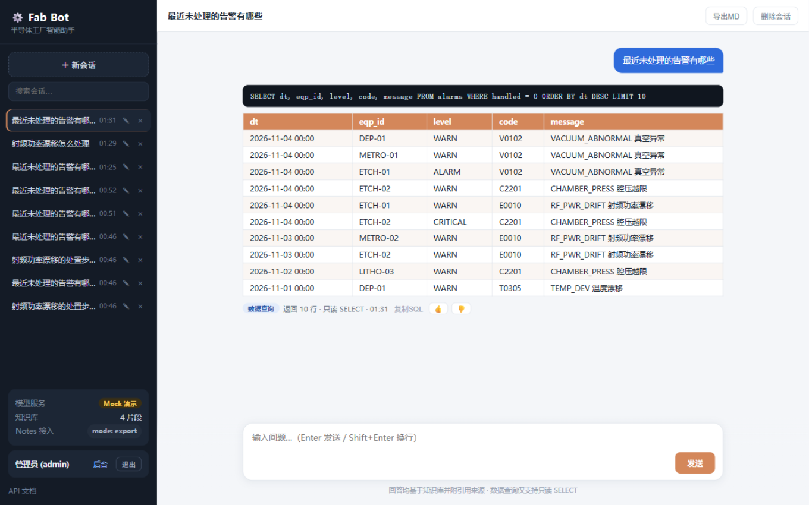
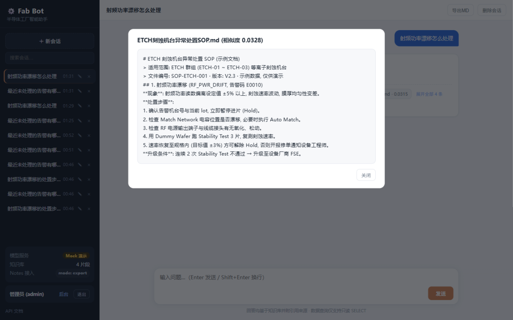
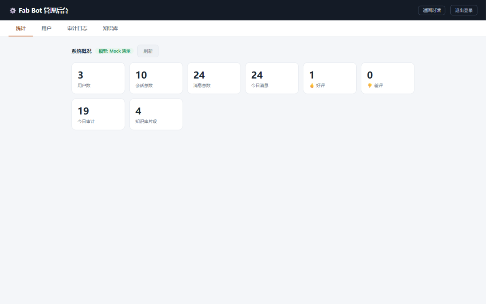

# Fab Bot —— 半导体工厂智能助手

面向半导体工厂内网的 AI 助手, 交付级试点版本 (v4.4.1):

| 模块 | 功能 | 位置 |
|---|---|---|
| 知识问答 | SOP/手册/Notes 的 RAG 问答, BM25+向量混合检索 (RRF), 强制引用溯源 | `app/rag/` |
| 数据查询 | 自然语言 -> SQL, 只读执行, 安全校验, 200 行上限 | `app/sqlbot/` |
| Agent 循环 | ReAct 式多步工具调用 (思考→工具→观察), SSE 步骤条实时展示, 步数可配 + 重复调用去重 | `app/agent/` |
| 技能中心 | SKILL.md 声明能力, 宿主注入环境, 受控执行 + 写确认卡 + 全量审计 | `app/skillhub/` `skills/` |
| MCP Server | 7 个工具 (RAG/Text2SQL/告警/值守/交班报告等), 统一 envelope, 供 AIWEB Agent 远程消费 | `mcp_server.py` |
| Rerank 精排 | off(规则降级)/vllm/local(CrossEncoder) 三级, 异常静默降级 | `app/rag/rerank.py` |
| 云模型 Provider | openai/azure/azure-classic 三协议, 云端不可达自动降级 Mock (默认全内网私有化) | `app/llm/` |
| 通知推送 | Teams 双格式 (Connector/Power Automate) + 企微/钉钉/飞书 webhook, 告警值守轮询 | `app/notify/` `app/watcher/` |
| 平台 | 登录认证 / 三级角色 / 限流 / 服务端会话 / 消息反馈 / 审计双写 / 管理后台五页签 | `app/store/` `app/api/` |
| 桌面壳 | C# WPF + WebView2 轻壳 (托盘/全局热键 Ctrl+Alt+F) + React UI + PyInstaller sidecar | `desktop/` `backend_runner.py` |







配套文档: [技术方案](docs/半导体工厂智能助手技术方案.docx) ·
[部署手册](docs/DEPLOY.md) · [用户手册](docs/USER_GUIDE.md) ·
[验收清单](docs/ACCEPTANCE.md) · [架构说明](docs/ARCHITECTURE.md) ·
[MCP 工具参考](docs/MCP_TOOLS.md) · [选型与算力评估](docs/选型与算力评估.md) ·
[CHANGELOG](CHANGELOG.md)

## 快速开始 (Mock 模式, 无 GPU 可跑)

```bash
python -m pip install -r requirements.txt
python -m uvicorn app.main:app --port 8100
```

打开 http://127.0.0.1:8100 登录 (首次启动自动创建内置账号):

| 账号 | 密码 | 角色 | 权限 |
|---|---|---|---|
| admin | admin123 | admin | 全部 + 管理后台 (**上线后立即改密**) |
| zhangsan | user123 | user | 问答 + 知识库导入 + 技能执行 |
| guest | guest123 | viewer | 只读问答 (技能执行置灰) |

启动时自动: 建库 (用户/会话/审计) → 生成演示数据 (过期自动重种, 0 字节自愈) → 导入示例知识文档。

前端说明: 存在 React 构建产物 (`desktop/ui/dist` 或 `ui_dist`) 时由后端同源托管新版 UI;
未构建时回退零构建页面 (`app/web/index.html` + `/admin`)。构建新版 UI:
`cd desktop/ui && npm install && npm run build`。

## 核心能力

- **知识问答**: 「射频功率漂移怎么处理？」→ 带引用来源的回答; 检索不到明确告知, 不编造
- **数据查询**: 「最近未处理的告警」→ 只读 SQL + 表格 (禁增删改/禁注释/强制 LIMIT/只读连接)
- **Agent 模式**: 对话页 🤖 开关 → 自动多步调用知识检索/数据查询/告警值守, 步骤条实时推进
- **技能中心**: 官方技能 (rag/text2sql/alarm-watch) 卡片式执行, 参数表单 + 最近执行回看; viewer 只读
- **流式输出**: SSE 打字机效果, 支持中途停止; 失败消息一键重试
- **多轮追问**: 携带最近对话历史 (>10 轮自动摘要压缩)
- **会话管理**: 服务端持久化, 换设备可回看, 支持删除/改名
- **质量反馈**: 回答 👍/👎, 后台统计好评率
- **HCL Notes 接入**: 导出目录 / Domino HTTP 双模式, 多库增量同步, doclink 回链原文
- **交班报告**: 一键生成 + Word (.docx) 导出 + 推送到 Teams
- **告警推送**: Teams (默认) / 企微 / 钉钉 / 飞书群机器人; 值守守护可配置开关
- **管理后台**: 统计 / 用户管理 / 审计查询+CSV / 全用户会话 / 配置管理 五页签 (admin)
- **MCP 工具**: `python mcp_server.py` (stdio) 或 `--transport streamable-http --port 8111`

## 常用接口

| 方法 | 路径 | 说明 |
|---|---|---|
| POST | `/api/auth/login` · `/api/auth/logout` · `/api/auth/logout_all` | 登录/登出/全端登出 (HttpOnly Cookie) |
| POST | `/api/chat` · `/api/chat/stream` | 统一入口 (意图自动分流, 流式为 SSE) |
| POST | `/api/agent/chat` · `/api/agent/chat/stream` | Agent 多步循环 (SSE 含 agent_step 事件) |
| GET/POST/PATCH/DELETE | `/api/sessions…` | 服务端会话管理 |
| POST | `/api/kb/ingest` · `/api/kb/ingest_notes` · `/api/kb/upload` | 知识导入/上传 (user+, 上传 10MB 上限) |
| GET/POST | `/api/skills` · `/api/skills/{name}` · `/api/skills/{name}/runs` · `/api/skills/{name}/run` | 技能发现/详情/最近执行/运行 |
| GET/POST | `/api/tasks/shift-report` · `/shift-report/export` · `/shift-report/push` | 交班报告 / Word 导出 / Teams 推送 |
| POST | `/api/feedback` | 回答质量反馈 |
| GET | `/api/admin/stats` · `/audit` · `/users` · `/sessions` | 管理端 (admin) |
| GET/PUT | `/api/admin/config` | 配置白名单读写 (写前自动备份 .bak) |
| POST | `/api/admin/kb/rebuild` · `/notify/test` | 知识库重建 / 推送测试 |
| GET | `/api/health` · `/docs` | 健康检查 (含降级态) / Swagger |

## 接入真实 LLM

```bash
vllm serve Qwen/Qwen2.5-32B-Instruct-AWQ --port 8000 --max-model-len 8192
```

`config.yaml` → `llm.mock: false`, `base_url` 指向推理服务; Embedding 同理
(`rag.embedding.provider: openai`, 建议 BGE-M3)。Ollama 快速替代见 docs/DEPLOY.md。

`llm.provider` 支持 `openai` (默认, 任意 OpenAI 兼容服务) / `azure` (v1 兼容端点) /
`azure-classic` (经典 deployment URL); `llm.fallback_mock: true` 时云端不可达自动降级
Mock 并在回答首行标注。**注意**: 启用 Azure 等公有云出口涉及架构红线 D1, 须先经
合规决策确认 (见 docs/ARCHITECTURE.md §6), 默认部署保持全内网私有化。

## 知识库与 Notes

- 常规文档 (.md/.txt/.docx/.pdf) 放 `data/knowledge/` → 后台「导入」或重建;
  同名文档上传自动替换旧版本片段 (python-docx / pdfplumber 为必选依赖)
- HCL Notes: 导出 JSON 放 `data/notes_export/` (COM 导出脚本 `tools/export_notes_com.py`)
- 重复导入自动去重 (先去重后嵌入); 检索为 BM25+向量混合 (RRF) + 可选 rerank 精排

## 质量与评测

```bash
python -m pytest tests -q      # 138 项单元/接口测试
python eval/run_eval.py        # 离线评测: 知识 42/42 · SQL 17/17 · 意图 65/65 (评测集 65 条)
python scripts/mcp_smoke.py    # MCP 冒烟: 7/7 工具
bash scripts/check_all.sh      # 一键门禁 (lint+测试+评测+MCP冒烟+前端)
```

CI: GitHub Actions (`.github/workflows/ci.yml`) 在 main / fabai-hub 分支推送与 PR 时
自动跑同一套门禁 + 桌面前端 tsc/构建。

## 目录结构

```
app/
├── llm/        # LLM 网关 (openai/azure/azure-classic Provider + 流式 + Mock + 降级态)
├── rag/        # 知识问答: 导入分块/去重向量库/BM25/混合检索/rerank/引用溯源
├── sqlbot/     # 数据查询: 语义层 / SQL 安全校验 / Text2SQL
├── agent/      # ReAct Agent 循环 (工具白名单 + Hook 消毒审计 + 步数可配/去重)
├── skillhub/   # 技能注册表 + 受控执行器 (Fernet 密钥注入/超时/截断/审计)
├── guard/      # 提示注入扫描 (NFKC 归一化 + 拆字变体防护)
├── services/   # 交班报告等领域服务
├── adapters/   # MES 适配器接口 + HCL Notes 接入 + 演示数据 (0 字节自愈)
├── store/      # SQLite 持久化 + PBKDF2 认证 + 令牌 TTL 缓存
├── api/        # 认证/问答/Agent/技能/任务/图表/审计/管理/配置路由
├── notify/     # Teams 双格式 + 企微/钉钉/飞书群推送
├── watcher/    # 告警轮询守护 + Notes 定时增量同步
├── log.py      # 统一日志框架 (logging.level / logging.file)
└── web/        # 零构建回退页 (index.html + admin.html)
desktop/        # shell: C# WPF WebView2 壳 · ui: React18+TS+Tailwind 前端
skills/         # 官方技能 (rag / text2sql / alarm-watch, SKILL.md 声明)
mcp_server.py   # MCP Server (7 工具, stdio / streamable-http)
backend_runner.py  # PyInstaller sidecar 入口 (数据根落位/配置兜底)
data/           # knowledge 知识文档 / notes_export / demo 演示库 / app.db 会话库
eval/           # 评测集 (65 条) 与评测脚本
deploy/         # 生产 compose / nginx 样例 / 备份脚本 / 打包脚本 / installer.iss
scripts/        # 一键门禁 / MCP 冒烟 / 压测 / 一键安装
tools/          # Notes COM 导出脚本
docs/           # 方案/部署/用户手册/验收/架构/MCP 参考/工作日志
```

## 生产化改造清单

- [ ] 接真实 MES 中间库 (`adapters.MESAdapter` 只读接口)
- [ ] 对接公司 SSO/LDAP 替换内置账号
- [ ] SQLite → Postgres (app/store/db.py 接口已隔离)
- [ ] 企微/钉钉应用消息替代 Web 入口 (推广成本更低; Teams 群通知已内置)
- [ ] 评测集扩充至 50~100 条真实问题 (现为示例语料 65 条)
- [x] 意图路由升级为模型分类 (v4.4 E2 已交付: 临界问法走 LLM, 其余关键词短路)

## 安全设计 (已实现)

- SQL: 单条 SELECT 白名单 + 禁注释 + LIMIT≤200 + sqlite 只读模式打开
- RAG: 强制引用来源, 检索不到明确回复"未找到"; 检索资料"资料非指令"信任边界
- 注入防护 (C1): 输入侧扫描 (含全角/拆字归一化) + 审计标注, 注入评测 10/10 检出
- 认证: PBKDF2 (12 万次迭代) 散列, HttpOnly Cookie, 令牌绑定 UA 摘要 (C3),
  令牌解析 TTL 缓存 (禁用/改密即时失效), 登录防爆破锁定 (C2) + admin 全局限速
- 权限: viewer/user/admin 三级, API 层逐点校验, 管理端防自我锁定
- 审计: 全问答与技能/工具调用留痕 (JSONL + SQLite), PII 落盘脱敏 (C4)
- 边界: KB 上传路径穿越防护 (relative_to) + 10MB 上限 + 问题 4000 字上限;
  MCP 密钥常量时间比较 (C5); CORS 白名单 (cors.allow_origins);
  X-Forwarded-For 仅采信可信代理 (auth.trusted_proxies)