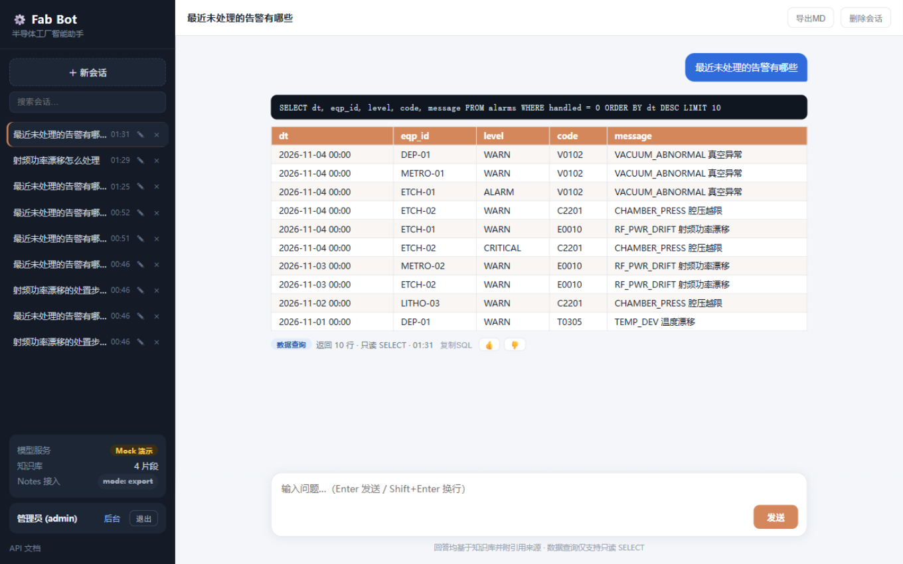
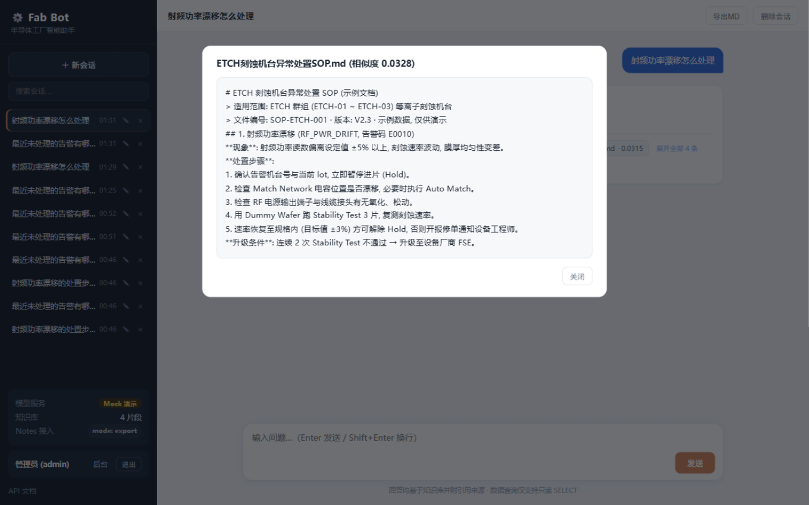
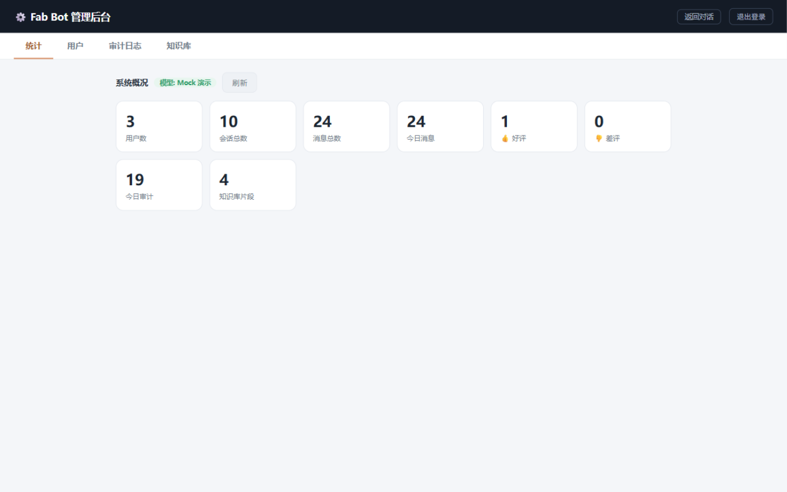

# Fab Bot —— 半导体工厂智能助手

面向半导体工厂内网的 AI 助手, 交付级试点版本 (v4.1):

| 模块 | 功能 | 位置 |
|---|---|---|
| 知识问答 | SOP/手册/Notes 的 RAG 问答, BM25+向量混合检索, 强制引用溯源 | `app/rag/` |
| 数据查询 | 自然语言 -> SQL, 只读执行, 安全校验, 200 行上限 | `app/sqlbot/` |
| 平台 | 登录认证 / 三级角色 / 限流 / 服务端会话 / 消息反馈 / 审计双写 / 管理后台 / 群推送 | `app/store/` `app/api/` `app/notify/` |







配套文档: [技术方案](docs/半导体工厂智能助手技术方案.docx) ·
[部署手册](docs/DEPLOY.md) · [用户手册](docs/USER_GUIDE.md) ·
[验收清单](docs/ACCEPTANCE.md) · [选型与算力评估](docs/选型与算力评估.md) ·
[CHANGELOG](CHANGELOG.md)

## 快速开始 (Mock 模式, 无 GPU 可跑)

```bash
python -m pip install -r requirements.txt
python -m uvicorn app.main:app --port 8100
```

打开 http://127.0.0.1:8100 登录 (首次启动自动创建内置账号):

| 账号 | 密码 | 角色 | 权限 |
|---|---|---|---|
| admin | admin123 | admin | 全部 + 管理后台 (**上线后立即改密**) |
| zhangsan | user123 | user | 问答 + 知识库导入 |
| guest | guest123 | viewer | 只读问答 |

启动时自动: 建库 (用户/会话/审计) → 生成演示数据 → 导入示例知识文档。

## 核心能力

- **知识问答**: 「射频功率漂移怎么处理？」→ 带引用来源的回答; 检索不到明确告知, 不编造
- **数据查询**: 「最近未处理的告警」→ 只读 SQL + 表格 (禁增删改/禁注释/强制 LIMIT/只读连接)
- **流式输出**: SSE 打字机效果, 支持中途停止
- **多轮追问**: 携带最近对话历史 (先问告警再问"那 ETCH-02 呢")
- **会话管理**: 服务端持久化, 换设备可回看, 支持删除/改名
- **质量反馈**: 回答 👍/👎, 后台统计好评率
- **HCL Notes 接入**: 导出目录模式 / Domino HTTP 模式, doclink 解析, 附件入库
- **告警推送**: 企微/钉钉群机器人 webhook (`app/notify/`)
- **管理后台** `/admin`: 统计 / 用户管理 / 审计查询 / 知识库重建

## 常用接口

| 方法 | 路径 | 说明 |
|---|---|---|
| POST | `/api/auth/login` · `/api/auth/logout` | 登录/登出 (HttpOnly Cookie) |
| POST | `/api/chat` · `/api/chat/stream` | 统一入口 (自动分流, 流式为 SSE) |
| GET/POST/PATCH/DELETE | `/api/sessions…` | 服务端会话管理 |
| POST | `/api/kb/ingest` · `/api/kb/ingest_notes` | 知识导入 (user+) |
| POST | `/api/feedback` | 回答质量反馈 |
| GET | `/api/admin/stats` · `/audit` · `/users` | 管理端 (admin) |
| POST | `/api/admin/kb/rebuild` · `/notify/test` | 知识库重建 / 推送测试 |
| GET | `/api/health` · `/docs` | 健康检查 / Swagger |

## 接入真实 LLM (vLLM)

```bash
vllm serve Qwen/Qwen2.5-32B-Instruct-AWQ --port 8000 --max-model-len 8192
```

`config.yaml` → `llm.mock: false`, `base_url` 指向推理服务; Embedding 同理
(`rag.embedding.provider: openai`, 建议 BGE-M3)。Ollama 快速替代见 docs/DEPLOY.md。

## 知识库与 Notes

- 常规文档 (.md/.txt/.docx/.pdf) 放 `data/knowledge/` → 后台「导入」或重建
- HCL Notes: 导出 JSON 放 `data/notes_export/` (COM 导出脚本 `tools/export_notes_com.py`)
- 重复导入自动去重; 检索为 BM25+向量混合 (RRF), 精确关键词 (机台号/告警码) 召回更稳

## 质量与评测

```bash
python -m pytest tests -q      # 63 项单元/接口测试
python eval/run_eval.py        # 离线评测: 知识/SQL/意图 三项 100% (评测集 49 条)
```

## 目录结构

```
app/
├── llm/        # LLM 网关 (OpenAI 兼容 + 流式 + Mock) 与 Prompt 模板
├── rag/        # 知识问答: 导入分块/去重向量库/BM25/混合检索/引用溯源
├── sqlbot/     # 数据查询: 语义层 / SQL 安全校验 / Text2SQL
├── adapters/   # MES 适配器接口 + HCL Notes 接入 + 演示数据
├── store/      # SQLite 持久化 + PBKDF2 认证 (v4.0)
├── api/        # 认证/问答/会话/反馈/审计/管理路由
├── notify/     # 企微/钉钉群推送 (v4.0)
└── web/        # index.html 聊天界面 + admin.html 管理后台 (零构建)
data/           # knowledge 知识文档 / notes_export Notes 导出 / app.db 会话库
eval/           # 评测集与评测脚本 (v4.0)
deploy/         # 生产 compose / nginx 样例 / 备份脚本 (v4.0)
tools/          # Notes COM 导出脚本
docs/           # 方案/部署/用户手册/验收清单/工作日志
```

## 生产化改造清单

- [ ] 接真实 MES 中间库 (`adapters.MESAdapter` 只读接口)
- [ ] 对接公司 SSO/LDAP 替换内置账号
- [ ] SQLite → Postgres (app/store/db.py 接口已隔离)
- [ ] 企微/钉钉应用消息替代 Web 入口 (推广成本更低)
- [ ] 意图路由升级为模型分类 (现为关键词粗分)
- [ ] 评测集扩充至 50~100 条真实问题

## 安全设计 (已实现)

- SQL: 单条 SELECT 白名单 + 禁注释 + LIMIT≤200 + sqlite 只读模式打开
- RAG: 强制引用来源, 检索不到明确回复"未找到"
- 认证: PBKDF2 (12 万次迭代) 散列, HttpOnly Cookie, 令牌过期清理, 禁用即时生效
- 权限: viewer/user/admin 三级, API 层逐点校验, 管理端防自我锁定
- 审计: 全问答留痕 (JSONL + SQLite), 登录失败亦记录
